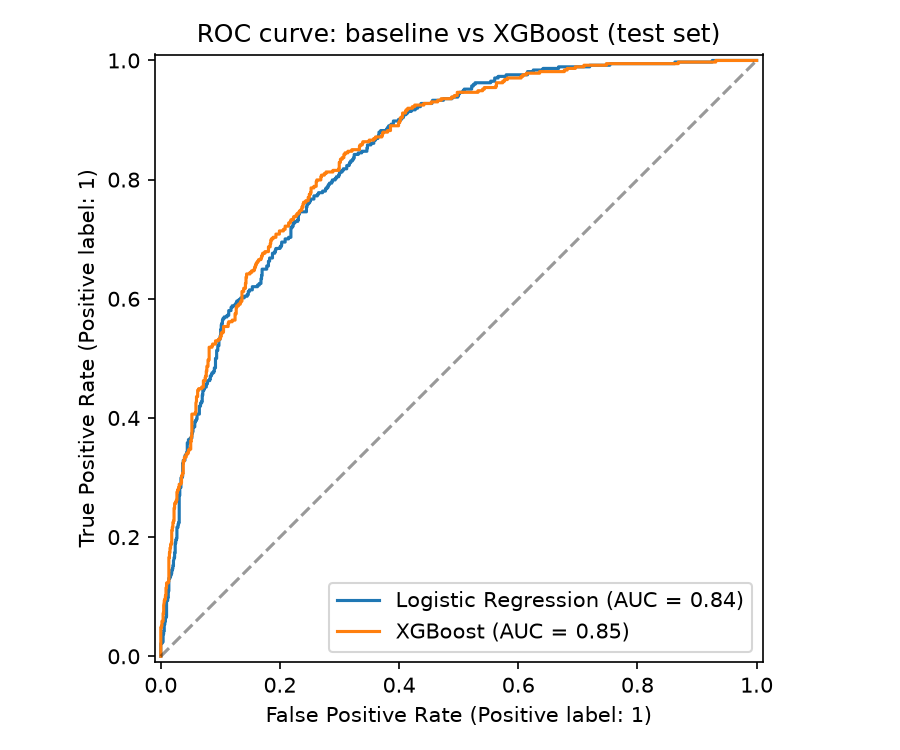
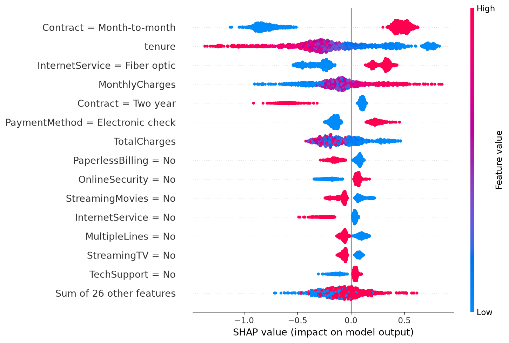

# 📉 Customer Churn Prediction + Risk Scoring App

End-to-end churn project on the **IBM Telco Customer Churn** dataset: SQL + pandas cleaning → logistic regression baseline → tuned XGBoost → SHAP explanations → Streamlit app that scores a customer's churn risk.

**Live demo:** https://dhruvivora16-telco-churn-appstreamlit-app-k6ktdf.streamlit.app/#high-risk

## Results (test set, 20% stratified hold-out, threshold = 0.5)

| Model | Recall | Precision | ROC-AUC |
|---|---|---|---|
| Logistic Regression (baseline) | 0.783 | 0.506 | 0.842 |
| XGBoost (tuned) | 0.799 | 0.520 | 0.847 |

Numbers come from `reports/metrics.json` after you run `python -m src.train`.

**Top 3 churn drivers (SHAP):** _1) … 2) … 3) …_ (from `reports/top_drivers.json`)




## Business takeaway
Contract type is the strongest churn driver, followed by internet service type and tenure. The highest-risk customers are newer, month-to-month subscribers on fiber optic plans. At a 0.5 threshold the tuned XGBoost model catches about 80% of churners (recall 0.80), at the cost of roughly half of flagged customers being false alarms (precision 0.52). That trade-off makes sense when a retention offer is cheap relative to the revenue lost from a departing customer. A practical first step is to target high-risk month-to-month customers with a contract-upgrade discount, and to tune the threshold using the real cost of an offer versus customer lifetime value.

## Project structure
```
sql/clean.sql        SQL cleaning (types, blanks, category collapsing, target encoding)
sql/analysis.sql     Business queries (churn by contract, tenure, revenue at risk)
src/data_prep.py     CSV -> SQLite -> clean table -> pandas validation -> processed CSV
src/features.py      Feature engineering + shared preprocessing
src/train.py         Baseline vs XGBoost, metrics, ROC + confusion matrix
src/explain.py       SHAP summary plots + top drivers
app/streamlit_app.py Interactive risk scorer with per-customer SHAP waterfall
```

## Run locally
git clone https://github.com/dhruvivora16/telco-churn.git && cd telco-churn
python -m venv .venv && source .venv/bin/activate   # Windows: .venv\Scripts\activate
pip install -r requirements.txt

# 1. Download the dataset from Kaggle (blastchar/telco-customer-churn) and place it at:
#    data/raw/WA_Fn-UseC_-Telco-Customer-Churn.csv

python -m src.data_prep      # SQL + pandas cleaning
python -m src.train          # baseline + XGBoost
python -m src.explain        # SHAP
streamlit run app/streamlit_app.py

## Method notes
- **Cleaning:** `TotalCharges` is text with 11 blanks (tenure = 0) → cast to numeric, filled with 0. "No internet/phone service" collapsed to "No" (already captured by `InternetService`/`PhoneService`).
- **Imbalance (~27% churn):** `class_weight="balanced"` for LR, `scale_pos_weight` for XGBoost; evaluated on Recall, ROC-AUC and PR-AUC rather than accuracy.
- **Tuning:** 25-iteration randomized search, 5-fold stratified CV, optimising ROC-AUC on the training split only.
- **Fair comparison:** same split, same 0.5 threshold for both models.
- **Limitations:** single snapshot, no time dimension; threshold should be set from retention-offer cost vs customer lifetime value.
